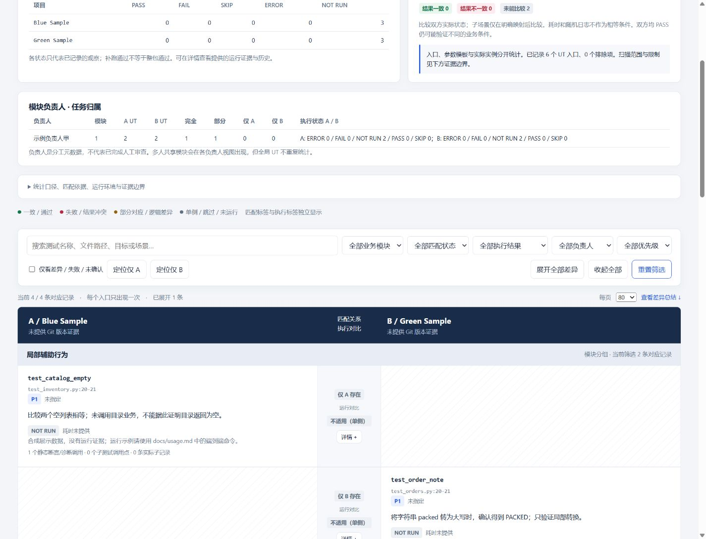

# UT-Analysis

[English](README_EN.md) · [安装](docs/installation.md) · [使用指南](docs/usage.md) · [更新记录](CHANGELOG.md)

**按产品需求分析单元测试，定位重要场景缺口，并持续追踪修复进展。**

UT-Analysis 是一个可安装的 Codex Skill。它将需求、测试代码、断言和实际执行证据关联起来，生成可离线浏览的交互式 HTML 报告。单项目分析是主要工作流，双项目或 Git 分支对比按需启用。

| 项目信息 | 版本 / 入口 |
| --- | --- |
| Skill | `0.7.1` · `$ut-analysis` |
| 报告模板 / Schema | `1.3.0` / `1.1.0` |
| 默认输出 | 调用者工作空间的 `docs/ut_result.html` |
| 运行要求 / 许可证 | Python 3.10+ · 标准库 · [MIT](LICENSE) |

## 功能与模式

| 模式 | 输入 | 分析内容 |
| --- | --- | --- |
| `audit` | 一个项目 | 需求与 UT 追踪、断言质量、实测覆盖率、P0/P1 测试缺口 |
| `compare` | 两个项目或同一仓库的两个分支 | 测试目标、场景、输入、断言和执行结果的双栏对比 |
| `full` | 两个项目及产品目标 | UT 对比与双方需求覆盖、质量门禁的综合分析 |

不指定模式时，一个项目默认 `audit`，两个项目默认 `compare`；需要综合分析时明确选择 `full`。

- **需求追踪**：关联验收条件、测试位置和断言证据，区分充分覆盖、部分覆盖、未覆盖与无法确认。
- **证据化判断**：使用实际覆盖率产物和显式质量门禁；缺少需求或运行数据时保留“证据不足”“未采集”。
- **安全分支分析**：指定分支时使用隔离 Worktree，保留原工作区分支和未提交修改。
- **离线交互报告**：支持模块分组、负责人归属、搜索筛选、分页和证据展开；匹配状态与执行状态独立展示。
- **持续迭代**：按 UT 名称或文件查询卡片，读取需求、质量与修复上下文；增量同步修复 Markdown。

## 安装

需要 Python **3.10+**，无需安装 Python 运行时依赖。Go AST 扫描另需 Go **1.18+**；执行目标测试需要该项目自身的工具链与依赖。

### Windows PowerShell

```powershell
git clone https://github.com/ImMappyJ/ut-analysis.git UT-Analysis
Set-Location UT-Analysis
python scripts/install_skill.py --mode link
```

### Linux / macOS

```sh
git clone https://github.com/ImMappyJ/ut-analysis.git UT-Analysis
cd UT-Analysis
python3 scripts/install_skill.py --mode link
```

链接安装使用 Windows 目录联接或 Unix 符号链接；需要独立副本时选择 `--mode copy`。默认安装到 `$CODEX_HOME/skills`，未设置时使用 `~/.codex/skills`。

安装后在 Codex 中调用 `$ut-analysis`。若当前会话尚未发现技能，请重新打开会话。项目以 Skill 和仓库脚本分发，不是 PyPI 安装包。更新、冲突处理及自定义安装目录见 [安装说明](docs/installation.md)。

## 快速开始

### 1. 按需求分析一个项目

```text
$ut-analysis
项目：./my-project
需求：./docs/acceptance.md
分析范围：订单模块
分析现有 UT 与验收条件的对应关系，指出断言问题和 P0/P1 测试缺口。
```

无需提供项目 B，也无需手写 JSON。Agent 负责需求理解和代码分析，Python 负责数据校验、统计、门禁计算与报告渲染。流程见 [单项目需求分析](references/single-project-analysis.md)。

### 2. 对比两个项目或分支

```text
$ut-analysis
任务模式：综合分析
对比项目 A：./my-project
项目 A 分支：main
对比项目 B：./my-project
项目 B 分支：feature/refactor
产品目标：./requirements/acceptance.md
项目模块负责人：示例负责人甲负责订单模块。
```

只需 UT 对比时使用“任务模式：对比”。A/B 可以指向不同仓库，也可以指向同一仓库；分支参数相互独立。未指定分支时使用当前工作区，包含未提交修改并记录其状态。

### 输入参数

| 参数 | 必填 | 说明 |
| --- | --- | --- |
| 项目 / 项目 A | 是 | 绝对路径、相对路径，或工作空间中可唯一定位的项目名称 |
| 项目 B | `compare` / `full` | 第二个项目或同一仓库的另一个版本 |
| 任务模式 | 否 | `audit`、`compare`、`full`；也支持对应中文描述 |
| 项目 A / B 分支 | 否 | 默认当前工作区；显式指定时隔离分析，不自动更新远程引用 |
| 产品目标 / 需求 | 否 | 自然语言、PRD、规格、用户故事或验收文档路径 |
| 分析范围 | 否 | 全项目或指定模块、文件、需求；报告保留统计范围与排除项 |
| 覆盖率目标 | 否 | 明确阈值或核心需求标准；不设置未经确认的强制阈值 |
| 模块负责人 | 否 | 模块与人员的自然语言映射，支持多人、多模块 |
| 输出 | 否 | 默认 `docs/ut_result.html`；已有报告需明确要求更新 |

## 报告示例

| 示例 | 展示内容 |
| --- | --- |
| [单项目分析](examples/audit_report.html) | 需求覆盖、质量问题与证据不足状态 |
| [双项目对比](examples/sample_report.html) | 双栏对齐、单侧测试、断言与场景差异 |
| [综合分析](examples/full_report.html) | Diff 与需求、覆盖率、质量视图切换 |
| [修复进展](examples/progress_report.html) | 已改、未改、原因与历史证据关联 |

下载 HTML 后直接用浏览器打开，无需 CDN 或服务。静态示例全部使用合成数据，测试结果为 `NOT RUN`；实跑演示另行采集运行证据。



## 从报告继续迭代

### 查询 UT 卡片与上下文

```text
$ut-analysis
报告：./docs/ut_result.html
测试文件：tests/test_inventory.py
项目：A
返回这个文件的全部 UT 卡片，以及关联需求、质量问题和修复进展。
```

也可提供“查找 UT：test_reject_invalid”。Agent 使用只读查询，无需重新扫描或执行测试；重名时返回候选，不强行匹配。

```sh
python scripts/query_report.py report.html --file tests/test_inventory.py --project A
python scripts/query_context.py report.html --requirement REQ-INVALID --detail
python scripts/query_context.py report.html --section progress --progress ./docs/ut-progress
```

上下文查询默认返回分页摘要，按需使用 `--detail` 读取代码、日志与证据。详见 [卡片查询](references/card-query.md) 和 [上下文查询](references/context-query.md)。

### 增量同步修复记录

修复 Markdown 以任务为单位同步到调用者的 `docs/ut-progress/`。未变化时只检查哈希；变化时只处理变化任务，减少重复读取与分析。报告的“修复进展”视图展示修改内容、未修改项与原因。

修复记录不会替换历史测试结果、语义匹配或质量门禁。完整流程见 [修复追踪](references/progress-tracking.md)。

## 验证与本地演示

在仓库根目录运行；Linux/macOS 可将 `python` 替换为 `python3`。

```sh
python -m unittest discover -s tests -v
python scripts/check_release.py
python scripts/validate_report.py examples/sample_report.html
python scripts/demo_e2e.py --mode audit --workspace .artifacts/audit-demo
python scripts/demo_e2e.py --workspace .artifacts/compare-demo
```

演示目录必须为空。演示只复制并执行随仓库发布的合成项目；即使测试全部 PASS，也会保留未覆盖的需求。可添加 `--without-owners --no-execution` 查看无负责人和未执行场景。

GitHub Actions 配置了 Windows、Linux、macOS × Python 3.10/3.12 矩阵。远程执行结果见 [Actions](https://github.com/ImMappyJ/ut-analysis/actions)；历史本地证据见 [验证记录](docs/verification.md)。

## 能力边界

- 内置 Python/Go AST 采集及 unittest、Go JSON、JUnit 运行记录适配。其他框架使用原生 collection/reporter，并按统一 Schema 归一化；动态发现或构建条件造成的缺口必须说明。
- 顶层测试入口与参数模板计数一次，子测试和参数实例单独记录。双方 PASS 不代表业务行为等价，缺少 UT 不代表功能未实现。
- 覆盖率来自原生工具产物，支持 Go 语句覆盖、coverage.py、LCOV、Cobertura。未采集不是 0%，高覆盖率不能抵消关键业务场景缺失。
- 测试执行器不是沙箱；运行前检查依赖和外部影响。Skill 不自动修改业务代码、迁移测试、安装依赖或发布项目。
- 真实业务数据、人员信息和日志保留在调用者工作空间，公开示例只使用合成数据。

## 文档导航

| 主题 | 文档 |
| --- | --- |
| 使用与架构 | [脚本参数](docs/usage.md) · [架构与职责](docs/architecture.md) |
| 需求与质量 | [需求追踪](references/requirement-traceability.md) · [质量规则](references/quality-rules.md) · [覆盖率采集](references/coverage-collection.md) |
| 对比与版本 | [语义匹配](references/matching-rules.md) · [Git 隔离分析](references/git-analysis.md) |
| 数据与扩展 | [Schema](references/report-schema.md) · [框架适配](references/framework-adapters.md) · [模板扩展](references/template-extension.md) |
| 维护与许可 | [更新记录](CHANGELOG.md) · [MIT License](LICENSE) |
