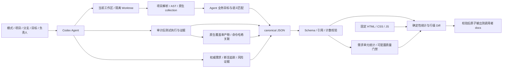

# Architecture

The primary workflow is one-project requirement-led UT analysis (audit). Diff is a two-project
branch; full combines both. `discovery.select_mode` / `prepare_projects.py` select audit for one
project and compare for two when mode is auto, preserving explicit choices and all legacy data modes.
The project/display name is UT-Analysis and the Skill invocation is `$ut-analysis`.
The internal Python package `ut_diff_report` remains compatible.
See [single-project-analysis.md](../references/single-project-analysis.md) for requirement-first steps.

SKILL.md 负责流程和语义决策；core.py 负责规则确定的校验、统计、转义和渲染。
discovery.py 只在明确空间有界定位，AST 不导入目标。execution.py 采集显式 argv 和事件，不是沙箱。
Go AST 保留构建标签和位置；原生 collection 决定可运行集合。静态与实际严格分开。

独立 Git 源仓库通过链接/复制安装；资源相对 Skill 根目录解析，输出相对调用者空间。
示例/测试均为合成数据，业务证据不进入源码。原 CSS 哈希记录 provenance；双栏同 grid 对齐，
分页和详情/子实例懒加载控制 DOM 数量。负责人 UI 可选，匹配/运行状态独立。
Skill、Schema、模板独立版本；见 template-extension.md。修复记录支持增量台账，UT 语义匹配缓存和自动迁移不在当前能力内。

quality.py validates product provenance and trace references, computes requirement-unit denominators and
explicit gates. coverage.py parses actual native counts; it never estimates coverage from source volume.
Git preparation records actual branch/SHA/dirty/source context; execution and coverage must match it.
Cleanup uses task-owned markers and ordinary clean-worktree removal, leaving user Worktrees untouched.

compare retains the baseline Diff. audit renders only A in a separate quality view. full switches between
Diff and quality views and compares common requirement IDs. Additive quality.css/js preserve the original
report.css byte-for-byte. Missing product evidence/coverage/approved policy stays explicit, not a zero or PASS.
