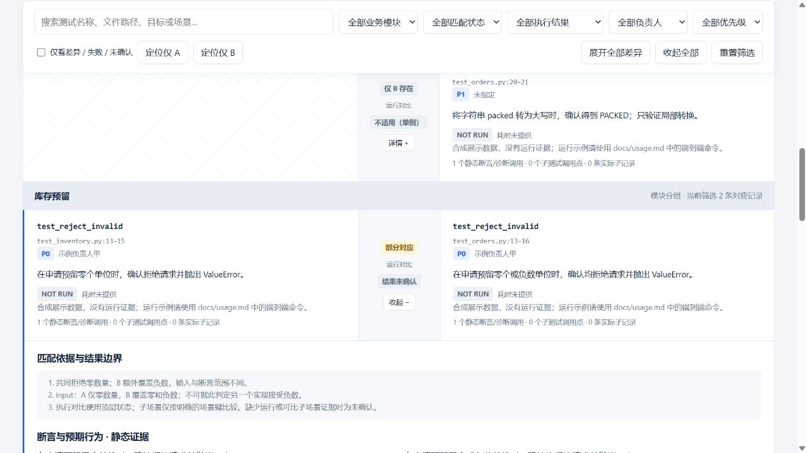
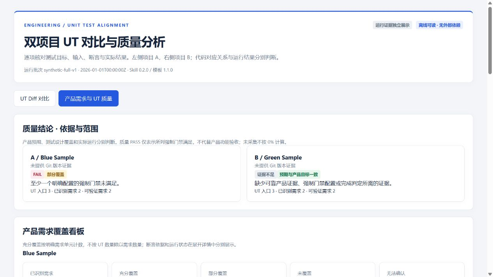
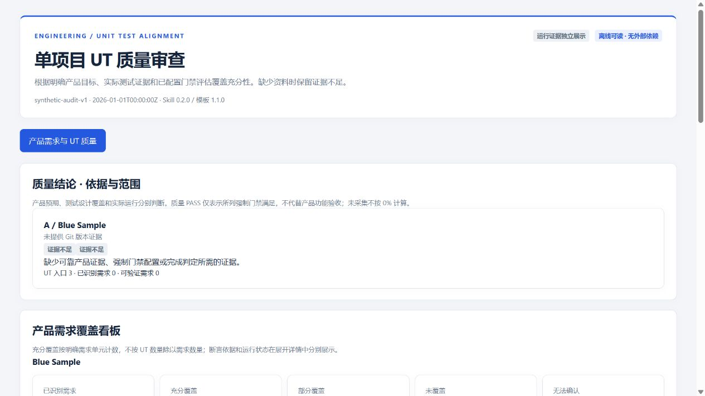

# 0.3.0 卡片查询增量验收

日期：2026-10-21。Skill 0.3.0 / 模板 1.2.0；原 Canonical Schema 不变。

- 新增 get_ut_card 与 query_report.py，从已有报告读取卡片，不运行脚本或测试、不修改报告。
- 同一 Diff 行 A/B 同名去重；不同路径重名返回 AMBIGUOUS；项目/路径/ID 消歧正常。
- exact 查询不自动模糊回退；NOT_FOUND、候选截断、限定名和实际子记录查询均有测试。
- compare/full 返回原左右卡片；audit 返回 A 单侧卡片；保留执行状态、时间、来源哈希和相关需求/问题证据。
- 新增 10 项测试；Windows 全量 63 项通过。WSL/Linux 63 项中 61 项通过，2 项因未安装 Go 跳过。
- 独立 Agent 试用确认 API 与 CLI 一致，NOT RUN/历史时间保持，所有输入报告 SHA 前后一致。
- 浏览器确认深链自动展开：full 的双栏/单侧行、分页第 2 页目标、audit 第 110 个入口；未知 ID 有提示。
- 旧版嵌入数据报告可查询且不被改写；不虚构其深链支持。
- 安装、结构/基本分发检查、原样式哈希检查和 HTML/JS 校验通过。现有用户 ZIP 未修改。



[使用与 API 契约](../references/card-query.md)。原版本验收记录保留如下。

---

# 0.2.0 本地验收记录

日期：2026-10-21。所有项目、需求与人员示例均为合成数据；没有发布或推送。
Skill 0.2.0 · 模板 1.1.0 · Canonical Schema 1.1.0（compare 兼容旧 1.0.0）。

## 已完成的能力

| 能力 | 验证结果 |
| --- | --- |
| compare | 原左右双栏、单侧留白、独立匹配/执行标签、搜索筛选、分页和懒加载详情保留 |
| audit | 仅 A、无虚构 B 或匹配行；可查看全部 UT、质量问题和需求/覆盖证据 |
| full | 原 Diff 与独立质量视图切换；共享需求 ID，分别展示两侧追踪、缺口与门禁 |
| 产品目标 | 需求来源、验收条件、UT 与有效断言关联；缺失来源不反推权威需求 |
| 质量门禁 | 实测代码覆盖、明确需求单元和测试有效性三层；没有批准的默认阈值 |
| Git | 各自缺省当前工作区，独立 A/B 显式分支，同仓库不同版本、detached HEAD、缺失分支和缓存远程引用 |
| 运行版本 | SHA、实际目录和源码指纹一致性；数据/配置变化可识别，报告输出不引发误报 |
| 资源安全 | 原分支、暂存/未暂存修改、未跟踪文件与已有 Worktree 保留；仅清理本次创建的干净 Worktree |
| 安装 | Windows 目录联接、Linux 符号链接、独立复制；其他工作空间默认输出 docs/ut_result.html |
| 分发 | 公开合成示例与私有 docs 报告/运行证据分离；复制安装排除后者 |

## 自动化证据

- Windows / Python 3.12：53 项全部通过，包含原生 Go 测试和真实覆盖率产物链路。
- WSL Ubuntu / Python 3：53 项中 51 项通过、2 项跳过；该 Linux 环境没有 Go 工具链。
- Go 原生采集使用合成项目：报告为语句覆盖率，保留实际计数、产物哈希、命令和工具版本，未冒充行/分支覆盖率。
- coverage.py JSON、LCOV、Cobertura 解析器与两步导出血缘通过合成格式契约测试；不声称这些原生工具都已在本机运行。
- 高代码覆盖率不能抵消核心需求缺口；缺需求/缺覆盖/混合测试范围/缺正式政策均不会无依据整体 PASS。
- 不同 SHA、分析目录或源码指纹的运行证据会被拒绝；合法对照可通过。
- Skill 官方结构校验、发布结构/基本隐私检查、固定样式 SHA 校验、HTML 结构/计数校验及 JS 语法检查通过。
- 当前 Codex 本地 app-server 的 skills/list 强制刷新可发现当时安装的唯一技能入口，更新后的 audit/branches 元数据已核实；此发现检查不启动模型推理。

完整私有命令/日志位于本地 .artifacts，已排除分发与 Git；本页仅保存可公开的验收结论。

## 独立试用与实际执行

使用 Skill 前的基线审查与使用后的独立试用均已完成。audit 仅 A 的真实合成执行为 3 个 UT
和 3 个 subTest 全部通过；没有产品目标、覆盖率工具数据或正式门禁，质量保持证据不足。

同一合成仓库的 main 识别并运行 1 个 UT，feature 识别并运行 2 个 UT，全部通过。
对应 1 对完全匹配、1 个仅 feature 存在；相同的常量算术断言不扩写为库存业务验证。
生成的本地验收报告记录真实分支/Commit/运行时间，源码和日志在清理隔离目录前已保存。
原始工作区与原有 Worktree 的前后记录一致。独立试用发现的指纹校验缺口已修复并重放验证。

## 页面检查

通过支持的浏览器工具检查 compare、audit、full 和实际分支执行报告。

- compare：模块/负责人/优先级/匹配/执行筛选、搜索、单侧定位、代码与断言 Diff、展开/收起正常。
- audit：没有 B；产品目标缺失显示证据不足，未采集覆盖率不显示为零；UT 清单搜索和详情正常。
- full：视图切换、共享需求条件/断言展开、搜索与状态筛选正常；核心缺口与未采集覆盖率分别展示。
- 实际分支报告显示 main/feature、相应短 SHA 和隔离快照标识；运行详情包含实际源码上下文。
- 390 像素窄屏与宽屏没有整页水平溢出，表格/代码允许局部滚动；报告无控制台错误。
- 大量数据检查使用 1,500 个合成入口：1,000 条比较行分页，单页仅渲染所选 40/80/160 条，详情按需创建。





## 可重复验证

```text
python -m unittest discover -s tests -v
python scripts/validate_data.py examples/sample_input.json
python scripts/validate_report.py examples/sample_report.html
python scripts/validate_data.py examples/audit_input.json
python scripts/validate_report.py examples/audit_report.html
python scripts/evaluate_quality.py examples/full_input.json
python scripts/validate_report.py examples/full_report.html
python scripts/check_release.py
```

## 验证边界

macOS 原生运行及 GitHub Actions 远程矩阵尚未执行，CI 已配置但没有推送触发。
WSL 的两个 Go 测试跳过不计为通过；Windows 的相应原生 Go 检查已通过。
框架/语言适配仍需结合项目原生 collection，不能将 AST 候选当作所有动态测试已收集。
产品语义与断言有效性由 Agent 根据证据审查，Python 验证结构并复算结论，不替代语义真伪判断。
本次没有对业务项目重新进行全量 UT/产品审查；原有业务报告保留。
Git 已本地初始化；尚无提交/远程仓库，没有自动公开或发布。
# File-card query acceptance — 2026-10-22

Skill 0.4.0, template 1.2.0. Added get_ut_cards and query_report.py --file.
Windows full unittest suite: 70 tests PASS. WSL Ubuntu card-query suite: 17 tests PASS.
New cases cover all-card completeness beyond 200, same-row deduplication, project scoping,
different-path counterparts, exact path matching, Windows/POSIX absolute paths with explicit roots,
audit/full quality evidence, legacy links and CLI option/output protection.
Distribution checks and all three synthetic example HTML validations passed.
Installed junction resolves to the updated source; installed API lookup returned matching sample cards.
No HTML/JS/CSS behavior changed; no new browser interaction claims. Repair-progress integration remains planned.

## Incremental progress and presentation acceptance — 2026-10-22

Skill 0.5.0 / template 1.3.0 implements the formerly planned repair-progress subset.

- Windows: 86 automated tests passed. WSL Ubuntu: all 16 progress tests passed.
- Four synthetic example reports and the local caller report passed structure/accounting validation.
- All three JavaScript files passed Node syntax checks; release structure, stylesheet provenance
  and basic privacy checks passed. These checks are not a comprehensive secret audit.
- Independent Skill workflow trial verified changed-only analysis, no-change reuse, summary-first
  queries, absent-baseline UTs, documentary evidence labels and unchanged historical data.
- Added regressions for nested Markdown fences, qualified-name lookup, Windows path normalization,
  changed evidence in derived reports, and legacy ledger migration from a forged ancestor pointer.
  Legacy migration now requires the exact physical original report; rejected migration leaves state intact.
- Browser: compare/quality/progress navigation, search, combined module/state filters, pagination,
  original-card jumps, collapsed quality sections, progressive detail disclosure, and 390px responsive
  layout checked. No JavaScript errors observed. Wide-screen screenshot retained in the caller workspace.
- The caller report kept its historical inventory, matching and execution totals. Notes were interpreted
  as DOCUMENT_ONLY; no business UT execution or coverage collection was performed during this upgrade.

macOS native execution and remote GitHub Actions were not run. Source is installed locally through
the existing Skill junction. No public repository was created and nothing was pushed or published.

## Report context queries — 2026-10-23

Skill 0.6.0, template 1.3.0 unchanged. Windows full regression: 96 tests passed.
WSL Ubuntu: all 10 new context-query tests passed. Release checks and Skill frontmatter validation
passed (the Windows validator requires `python -X utf8` for this UTF-8 Markdown file).

Validated single-project and two-project requirement traces, exact issue/module filtering,
untraced requirements, summary/detail evidence, independent pagination, absent quality data,
ambiguous UT names, notes-only new tests, live-note staleness, CLI fresh-output protection and
unchanged input report bytes. The installed CLI returned requirement excerpts when invoked from
an independent temporary workspace. A read-only caller-report smoke check retrieved existing
requirements, acceptance criteria, quality findings and stale-ledger signals without changing them.

No HTML/CSS/JS changes, no business tests rerun, no report regeneration or note synchronization.
macOS and remote CI were not executed; no publish/push performed.

## Single-project primary workflow — 2026-10-26

Skill 0.7.0 / template 1.3.0. Windows: all 101 automated tests passed. WSL Ubuntu: all 5 new
single-project tests passed. Explicit comparison requests still reject missing project B; one-project
preparation defaults to audit and accepts the neutral project/branch aliases. Non-Git project preparation
and existing compare fixtures remain supported.

Executed the one-project synthetic audit demo: three top-level UTs PASS, one requirement SUFFICIENT,
one PARTIAL and one UNCOVERED; the explicitly documented core-requirement gate FAILs. This demonstrates
that passing existing UTs cannot erase missing acceptance scenarios. Coverage remains uncollected.
Only the Blue project was scanned/executed; no second project or artificial comparison rows were created.
The NOT RUN variant and requirement/source queries also passed.

All four static example reports and the actual synthetic audit report passed structure/accounting
validation. Skill validation and release/privacy checks passed. HTML/CSS/JS were unchanged; this turn
does not claim a new browser layout validation. No business project scan/test or historical report
regeneration was performed. macOS and remote CI were not run; nothing was published or pushed.


## Project and Skill rename — 2026-10-26

Version 0.7.1: project/display name UT-Analysis; Skill command/install directory ut-analysis.
The complete source checkout (including Git and local artifacts) was moved intact, and the old
installation junction was replaced with a verified junction to the new checkout. An installed CLI
smoke test from an independent workspace selected audit correctly; Skill validation and release
checks passed. Python imports and archived report data remain unchanged. The previous ZIP is
retained only as a local legacy artifact; the new distribution uses the updated command.

Windows full regression after the rename: 101 tests passed.
